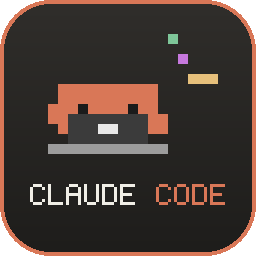

<p align="center">
  
</p>

<h1 align="center">Clauddy</h1>

<p align="center">
  A tiny pixel Claude that hangs out on your Windows desktop and reacts to Claude Code.
</p>

<p align="center">
  
</p>

<p align="center"><a href="README.ru.md">по-русски</a></p>

> Fan project, not affiliated with or endorsed by Anthropic or Spotify.

## What it does

**With Claude Code**

- thinking: a light bulb blinks over his head
- using tools: pulls out a laptop and types code
- waiting for you: waves and flashes a "!"
- done: a little jump with sparkles
- a tool failed: x x eyes and a drop of sweat
- new session: says hi

**On his own**, in random order and not too often: walks along the taskbar and follows your cursor with his eyes, reads a book, drinks coffee (more in the morning), does a workout, chases a butterfly, climbs onto windows and rides them around, sometimes jumps and lands flat as a pancake, falls asleep when you're away from the computer.

**With you**

- drag him anywhere, across monitors too
- pet him: move the cursor back and forth over him 3 times
- freeze: he stays exactly where you put him
- clones: up to 8 Claudes copying the main one

**Spotify** (desktop app, no Premium needed): a player over his head with cover, title, artist, a seekable timeline, shuffle, repeat (off / playlist / track) and a "surprise me" button that starts a radio from the current track. The heart adds or removes the track from Liked Songs, and there's a searchable Liked Songs list where one click plays a track.

<p align="center"></p>

The app speaks Russian and English, switch it in the menu.

Grab `Clauddy.zip` from [Releases](../../releases), unzip it and run `Clauddy.exe`. Needs Windows 10/11 x64.

The exe isn't code-signed, so SmartScreen will warn you: click "More info" → "Run anyway". If you'd rather not trust a binary, build it yourself (see below).

### Hooking it up to Claude Code

Right-click Claude (or the tray icon) → **connect to Claude Code**, then restart Claude Code.
This adds http hooks to `~/.claude/settings.json` and saves your old file as `settings.json.clauddy-backup` first.

The hooks only talk to `http://127.0.0.1:47613` on your own machine, nothing goes to the internet.
To undo it use **disconnect from Claude Code** in the same menu.

## Build from source

```powershell
python -m pip install -r requirements.txt
.\build.ps1        # -> dist\Clauddy.exe
```

Run without building: `python clauddy.py`. Dump every animation frame: `python clauddy.py --preview sprites.png`.

## How it's put together

| File | What's inside |
|---|---|
| `clauddy.py` | the pet: sprites drawn in code, physics, activities, tray, a local HTTP server for the hooks |
| `media.py` | Spotify: now playing via Windows media sessions, Liked Songs via `spotify_cli.exe` that ships with Spotify |
| `panel.py` | the player panel |
| `picker.py` | the Liked Songs list |
| `i18n.py` | all the text the app shows, in Russian and English |
| `make_icon.py` | draws the icon from the same sprites |

Settings live in `%APPDATA%\Clauddy`.

## License

[MIT](LICENSE)
